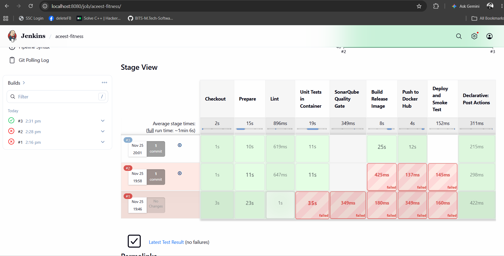
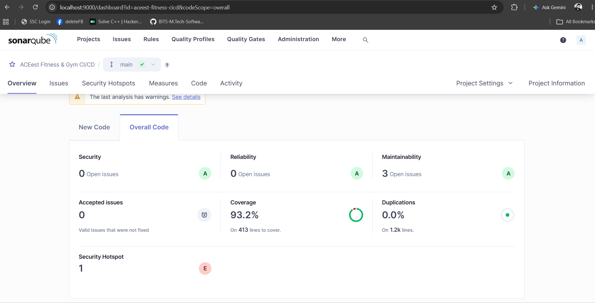
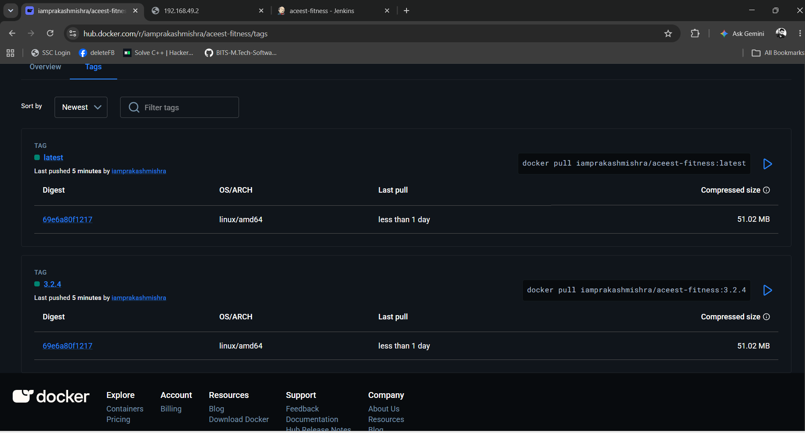

# Assignment Report — Automated CI/CD for ACEest Fitness & Gym

## 1. Overview

ACEest Fitness & Gym needed a repeatable, test-driven path from source commit to
production without downtime. The solution replaces the original desktop-style
numbered programs with a modular Flask web application and wraps it in an
end-to-end DevOps pipeline. Git and GitHub provide versioning, Jenkins performs
build and validation, Pytest verifies behaviour, SonarQube enforces code
quality, Docker/Podman package the application, and Kubernetes runs five
progressive delivery strategies with automated rollback.

The deployed service exposes `/api/health` and `/api/version`, which report the
release version, strategy, colour, Git commit and build number. These endpoints
are used by the pipeline as smoke tests and make every strategy observable
during promotion or rollback.

## 2. Architecture

The pipeline follows a single trunk with short-lived branches. Developers work
on `develop` and feature branches, open pull requests into `main`, and tag
releases with semantic versions. A GitHub webhook (with a five-minute SCM poll
as fallback) triggers the Jenkins job defined by the `Jenkinsfile` in the
repository.

Jenkins stages are:

1. **Checkout** — clone the commit that triggered the build and capture the short Git SHA.
2. **Prepare** — create a clean virtual environment, install pinned dependencies, run `pip check` and byte-compile sources.
3. **Lint** — run Flake8 with a 100-character line limit.
4. **Unit Tests in Container** — build the `test` stage of the multi-stage Dockerfile and execute Pytest inside it. JUnit XML and Cobertura coverage XML are copied back and published; the build fails below 90% coverage.
5. **SonarQube Quality Gate** — run the SonarQube Scanner from a container and poll `/api/qualitygates/project_status` until the gate passes. Enable with `RUN_SONAR=true` and a `sonar-token` credential; build #3 used `RUN_SONAR=false` because the scan had already been executed standalone with the same configuration.
6. **Build Release Image** — build the slim, non-root runtime image with version, strategy, colour and commit injected as build arguments. Tag it with the semantic version, the strategy and `latest`.
7. **Push to Docker Hub** — authenticate with Jenkins credentials and push versioned and latest tags.
8. **Deploy and Smoke Test** — load the image into Minikube where applicable, apply the selected strategy manifests, promote the candidate, and verify `/api/health`.

A failure at any point archives reports and, once a deployment has started,
calls `scripts/rollback.sh` for the selected strategy. No secret is stored in
the repository: registry and scanner tokens come from environment variables or
Jenkins credentials.

The runtime image is based on `python:3.12-slim`, installs dependencies in a
separate builder virtualenv, runs Gunicorn with graceful timeouts, uses an
unprivileged user, and declares a health check. The same Dockerfile works with
Podman by replacing the client command.

## 3. Application and testing

The application is split into `db.py` (SQLite schema and request-scoped
connections), `repository.py` (SQL isolated from HTTP), `services.py` (pure
business logic), `routes/api.py` (JSON API), `routes/views.py` (HTML UI), and
`version.py` (release metadata). The application factory allows development,
test and production configurations to be created on demand; tests use a fresh
temporary database and wipe tables between cases.

The Pytest suite covers services, repository operations, API status codes,
HTML views, release metadata and the `/api/version` endpoint, so a misconfigured
container image fails before deployment.

Verification commands and observed results:

```bash
scripts/verify.sh
# Byte compilation OK; Flake8 0 errors; 92 passed; 100% coverage
```

```bash
docker build --target test -t aceest-fitness:test .
cid=$(docker create aceest-fitness:test python -m pytest \
  --junitxml=reports/junit.xml --cov=aceest \
  --cov-report=term-missing --cov-report=xml:reports/coverage.xml \
  --cov-fail-under=90)
docker start -a "$cid"
docker cp "$cid:/app/reports/." reports/
docker rm "$cid"
python3 scripts/normalize-coverage.py reports/coverage.xml
# 92 passed; Required test coverage of 90% reached. Total coverage: 100.00%
```

`scripts/normalize-coverage.py` makes the Cobertura source path relative so
SonarQube imports the same report from a local workspace or a Jenkins workspace.

## 4. Version control evidence

```bash
git remote -v
git log --oneline --decorate --all
git tag
```

`main` is the release branch and `develop` receives feature work. The original
numbered samples are retained in `versions/legacy/`; `scripts/git-bootstrap.sh`
can create the branch/tag history for a fresh clone. The GitHub repository is
https://github.com/iamprakashmishra0/aceest-fitness-cicd and the pushed `main`
head contains the final Jenkinsfile, manifests, reports and PDFs.

## 5. Deployment strategies

| Strategy | Mechanism | Zero-downtime behaviour | Rollback |
| --- | --- | --- | --- |
| Rolling update | One Deployment, `maxSurge: 1`, `maxUnavailable: 0`, readiness probes, `preStop` drain | Pods replaced gradually while capacity is maintained | `kubectl rollout undo` |
| Blue-green | Two Deployments; Service selector switched after green is ready | Both versions run; switch is atomic | Switch selector back to blue |
| Canary | 3 stable + 1 canary replica behind one Service | 25% of requests exercise the new build; weight changed by scaling | Scale canary to zero |
| Shadow | Istio `VirtualService` mirrors stable traffic to shadow pods | Shadow receives real requests without affecting responses | Delete the mirror rule |
| A/B testing | NGINX canary Ingress with `X-Cohort: beta` header and weight | Cohorts routed deterministically; weight adjustable | Set canary weight to zero |

`scripts/deploy.sh` applies the manifests, patches the candidate image and
environment, waits for the rollout, promotes the candidate and runs a smoke
test. `scripts/promote.sh` and `scripts/rollback.sh` provide one-command traffic
control for every strategy. Exact commands are in
`docs/DEPLOYMENT_STRATEGIES.md` and its PDF version.

Verification performed locally:

```bash
minikube start --driver=docker
scripts/build-image.sh 3.2.4
minikube image load aceest-fitness:3.2.4
scripts/deploy.sh rolling-update aceest-fitness:3.2.4
EXPECTED_VERSION=3.2.4 scripts/smoke-test.sh
kubectl port-forward --address 0.0.0.0 -n aceest svc/aceest 8081:80
curl http://localhost:8081/api/version
# {"build":"local","commit":"unknown","release":"green","strategy":"rolling-update","version":"3.2.4"}
```

Port `8080` is occupied by Jenkins, so the cluster uses port `8081`. On WSL2 the
Windows host can use the adapter IP from `ip -4 addr show eth0 | grep inet`,
for example `http://172.27.153.248:8081/api/version`.

## 6. Container and registry evidence

```bash
scripts/build-image.sh 3.2.4 canary green
DOCKERHUB_USER=<username> DOCKERHUB_PASSWORD=<access-token> \
  scripts/push-image.sh 3.2.4
# Pushed <username>/aceest-fitness:3.2.4 and <username>/aceest-fitness:latest
```

Published repository: https://hub.docker.com/r/iamprakashmishra/aceest-fitness
with tags `3.2.4` and `latest`. Jenkins build #3 repeated this push from the
pipeline using the `dockerhub-credentials` credential.

## 7. SonarQube evidence

```bash
docker-compose up -d sonar-db sonarqube
# open http://localhost:9000, create a token in My Account -> Security -> Tokens
SONAR_HOST_URL=http://localhost:9000 SONAR_TOKEN=<token> APP_VERSION=3.2.4 \
  scripts/sonar-scan.sh
```

Result: **PASS (OK)** quality gate, coverage `93.2%`, 0 bugs, 0 vulnerabilities,
3 code smells, 0% duplication, 768 lines of code. Project URL:
http://localhost:9000/dashboard?id=aceest-fitness-cicd. Full details are in
`reports/sonar-report.md`.

## 8. Jenkins evidence

```bash
GITHUB_REPO_URL=https://github.com/iamprakashmishra0/aceest-fitness-cicd.git \
DOCKERHUB_USER=<username> DOCKERHUB_PASSWORD=<access-token> \
SONAR_TOKEN=<sonarqube-token> \
docker-compose -f jenkins/docker-compose.yml up -d --build
```

Open `http://localhost:8080` (`admin` / `change-me`) and run
`aceest-fitness` with `DEPLOY_STRATEGY=rolling-update`, `APP_VERSION=3.2.4`,
`PUSH_IMAGE=true`, `DEPLOY_TO_K8S=false`. Successful build:
http://localhost:8080/job/aceest-fitness/3/ — build #3, `SUCCESS`. The console
shows 92 tests, 100% coverage, image tags and Docker Hub pushes.

## 9. Challenges and mitigations

**Desktop-to-web migration.** The supplied samples were numbered Tkinter
programs with SQLite and PDF code. They were retained in `versions/legacy/`
for traceability, while the domain model was ported into a Flask application
with explicit layers. This preserved behaviour and made it testable.

**Stateful demo data in multiple replicas.** SQLite files are local to each
pod. The manifests therefore mount an `emptyDir` and seed identical demo data.
The limitation is documented; production would replace it with a shared
database and a migration step.

**Minikube image availability.** The CI image uses `IfNotPresent` and the
deploy script loads the image into Minikube when the CLI is present. For remote
clusters the pipeline pushes to Docker Hub and Kubernetes pulls the same tag.

**Advanced traffic control prerequisites.** Plain Services cannot mirror
requests or route by header, so Istio and NGINX Ingress manifests are provided
with explicit prerequisites and fallback notes instead of pretending a Service
alone implements those strategies.

**Secret handling.** Registry credentials and Sonar tokens are supplied via
Jenkins credentials/environment variables or the gitignored `.env` file;
compose defaults are placeholders and must be changed before exposure.

**WSL2 browser access.** `minikube ip` is not reachable from Windows, and port
8080 is used by Jenkins. A `kubectl port-forward --address 0.0.0.0 ... 8081:80`
plus the WSL adapter IP gives a working browser endpoint.

## 10. Key automation outcomes

- A commit triggers build, lint, containerised tests, coverage enforcement, static analysis, image publication, deployment and smoke testing without manual steps.
- Quality gates block promotion: lint errors, failing tests, coverage below 90%, or a failed SonarQube quality gate stop the pipeline.
- Every image is immutable and tagged with a semantic version and Git SHA; `/api/version` proves which release is live.
- All five delivery strategies are reproducible from manifests and scripts, each with a tested rollback path.
- Reports (JUnit, coverage, SonarQube) are archived by Jenkins for auditability.

## 11. Evidence screenshots

The following screenshots are captured from the running Jenkins, SonarQube and
Docker Hub instances and are also included in this PDF. The original files are
stored in `docs/evidence/` for auditability.

**Jenkins — successful pipeline build #3**



**SonarQube — project overview and passing quality gate**



**Docker Hub — published `aceest-fitness` repository and tags**



## 12. Submission evidence

| Item | Evidence |
| --- | --- |
| GitHub repository | https://github.com/iamprakashmishra0/aceest-fitness-cicd |
| Jenkins successful build | http://localhost:8080/job/aceest-fitness/3/ (build #3, SUCCESS) |
| SonarQube project | http://localhost:9000/dashboard?id=aceest-fitness-cicd — gate OK, coverage 93.2%, 0 bugs, 0 vulnerabilities |
| Docker Hub repository | https://hub.docker.com/r/iamprakashmishra/aceest-fitness (tags `3.2.4`, `latest`) |
| Cluster endpoint | http://localhost:8081 (or `http://172.27.153.248:8081` from Windows/WSL2) |
| This report as PDF | `docs/ASSIGNMENT_REPORT.pdf` |
| Deployment runbook as PDF | `docs/DEPLOYMENT_STRATEGIES.pdf` |

The localhost links require Jenkins, SonarQube and Minikube to be running.
PDF versions are generated from the Markdown sources with WeasyPrint so the
submission contains both editable and read-only copies.
